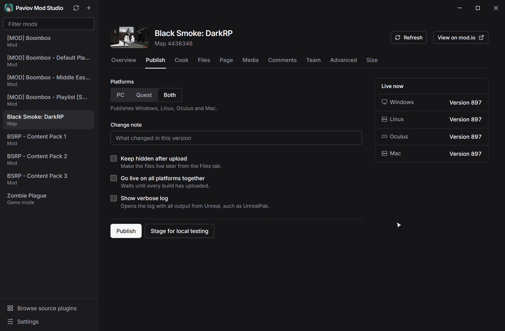
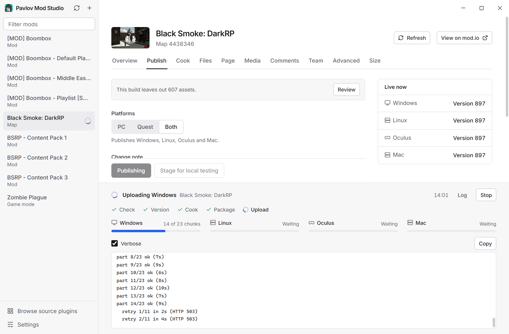
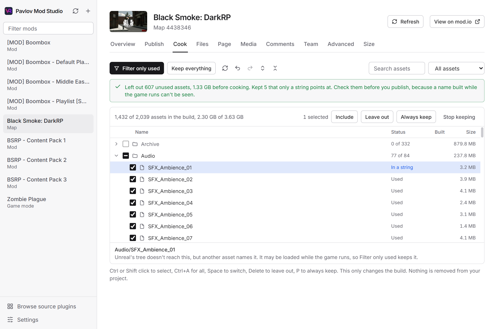
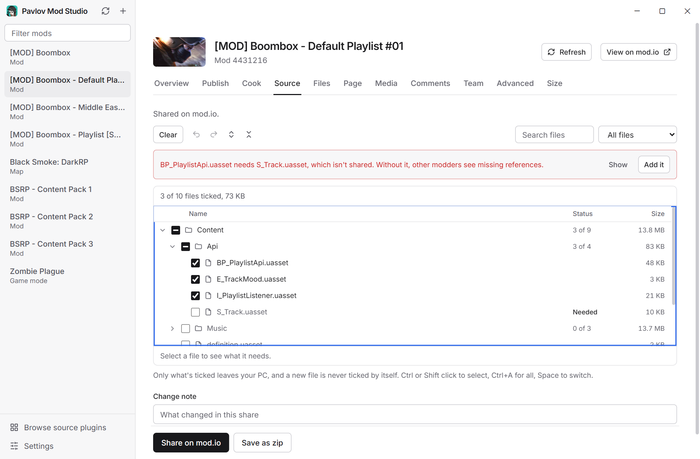
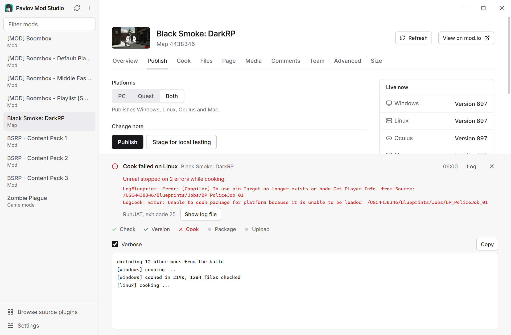
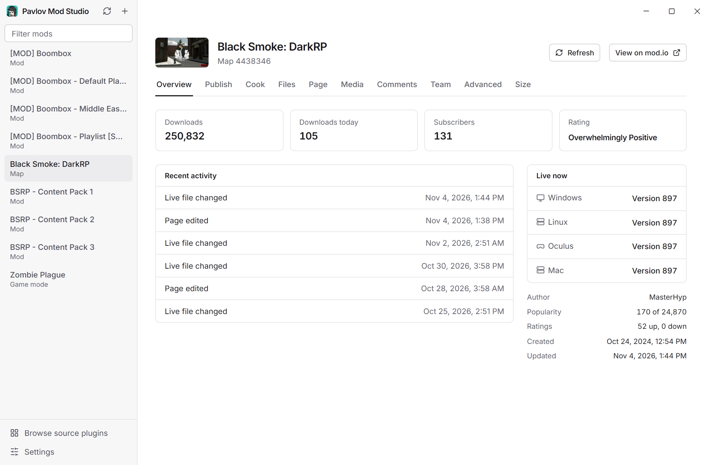
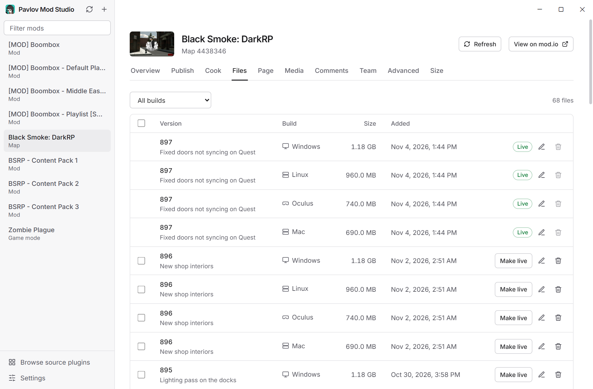
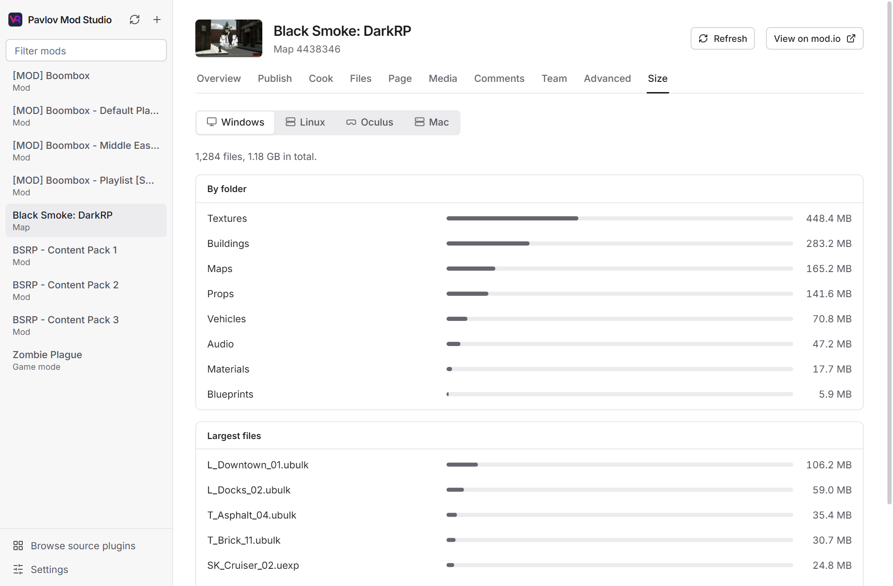
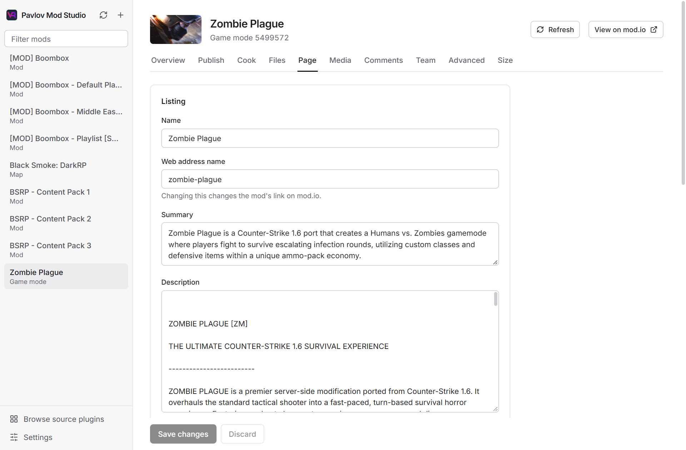
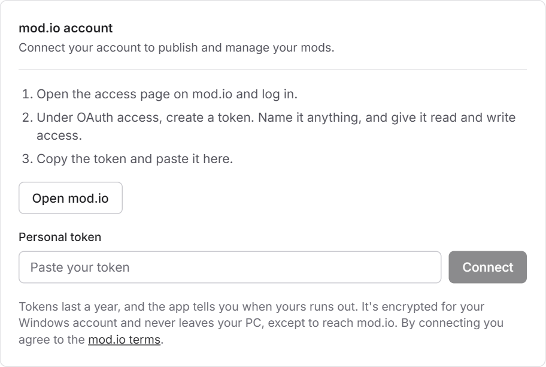

  

<h1 align="center">Pavlov Mod Studio</h1>

  <strong>Cook, publish and manage your Pavlov mods from one desktop app.</strong> 
  When an upload breaks, it picks up where it stopped.

  

  
  
  

  <a href="#quick-start">Quick start</a> &nbsp;|&nbsp;
  <a href="docs/guide.md">User guide</a> &nbsp;|&nbsp;
  <a href="docs/cli.md">Command line</a> &nbsp;|&nbsp;
  <a href="CONTRIBUTING.md">Contribute</a>

  

## Why use it

The modkit's Upload button works until something goes wrong. A dropped connection stops the upload and clears the queue, so you start again. Mod Studio does the same job from outside the editor, and it's built around that moment.

| | Modkit Upload button | Pavlov Mod Studio |
|---|---|---|
| **An upload fails** | Stops and clears the queue | Retries that chunk, and Resume finishes the rest |
| **Unused assets** | Everything in the plugin ships | Leave out what nothing uses, in an Explorer-style tree |
| **A build breaks** | A message box | Names the step and the build, with Unreal's errors and the full log |
| **Rolling back** | The mod.io website | One click in the Files tab |
| **Page, media, comments** | The mod.io website | All in the app |

## What it does

### Publish without babysitting it

One click bumps the version, cooks every build, packages them and uploads to mod.io. Uploads go in 50 MiB chunks. If a chunk fails, only that chunk is retried. If the whole run stops, **Resume** skips everything already finished and sends only what's missing.

<picture>
  <source media="(prefers-color-scheme: dark)" srcset="docs/media/publish-dark.png">
  
</picture>

### Ship only what your mod uses

Unreal cooks every asset in a mod's plugin, used or not. The Cook tab shows them all in a tree you use like Windows Explorer, with Ctrl and Shift selection, search and undo. **Filter only used** finds what nothing uses and leaves it out, which can shrink a download a lot.

It only leaves out what both Unreal's dependency tree and a scan of your files agree on. Other mods in your modkit count as users, so a content pack won't lose assets another mod needs. Nothing is removed from your project, and every finished pak is checked against your choices.

<picture>
  <source media="(prefers-color-scheme: dark)" srcset="docs/media/cook-dark.png">
  
</picture>

### Share exactly what you choose

Other modders might need one struct or interface from your mod, not the whole thing. The Source tab lists every file, and only what you tick leaves your PC. It warns when those files need something you left out, and when they point at another mod. Then share straight away, without a new build.

<picture>
  <source media="(prefers-color-scheme: dark)" srcset="docs/media/source-dark.png">
  
</picture>

### Know exactly what broke

When a build fails, you see the step, the build, Unreal's own errors and a link to the full log. **Stop** ends a cook partway. Every pak is checked before it uploads, and a build stops if it contains another mod's files, so you can't publish someone else's work by accident.

<picture>
  <source media="(prefers-color-scheme: dark)" srcset="docs/media/failure-dark.png">
  
</picture>

### Run your mods without the website

Everything you'd go to mod.io for is in the app, and each mod loads once so switching between them is instant.

<table>
  <tr>
    <td width="50%">
      <picture>
        <source media="(prefers-color-scheme: dark)" srcset="docs/media/overview-dark.png">
        
      </picture>
      
<strong>Overview</strong> Downloads, ratings, activity and what's live

    </td>
    <td width="50%">
      <picture>
        <source media="(prefers-color-scheme: dark)" srcset="docs/media/files-dark.png">
        
      </picture>
      
<strong>Files</strong> Make any version live, edit or delete files

    </td>
  </tr>
  <tr>
    <td width="50%">
      <picture>
        <source media="(prefers-color-scheme: dark)" srcset="docs/media/size-dark.png">
        
      </picture>
      
<strong>Size</strong> See what takes up the space in each build

    </td>
    <td width="50%">
      <picture>
        <source media="(prefers-color-scheme: dark)" srcset="docs/media/page-dark.png">
        
      </picture>
      
<strong>Page</strong> Listing, visibility, permissions and credits

    </td>
  </tr>
</table>

Also in the app:

- **Media, comments and team.** Manage screenshots and videos, reply to and moderate comments, and see who's on the team.
- **New mods.** Create a mod on mod.io and set up its plugin and definition in one step.
- **Source sharing.** Choose exactly which files other modders get, down to a single struct or interface. Nothing leaves your PC unless you tick it, and the app warns if those files need something you left out. Browse and download what others share too.
- **Local testing.** Stage a build to a folder without touching mod.io.
- **Keeps out of your way.** Unreal can stay open or closed while you publish, and the app follows your Windows light or dark setting.
- **Stays inside mod.io's limits.** The app reads only what you open and paces itself under mod.io's request limit.
- **Updates itself.** New versions install on launch, and never during a run. You can turn this off in Settings.

## Quick start

**You need** Windows 10 or 11, the [Pavlov modkit](https://github.com/vankruptgames/PavlovVR-ModKit), Unreal Engine 5.1 and a [mod.io](https://mod.io) account.

1. **[Download the installer](https://github.com/PavlovVR/pavlov-mod-studio/releases/latest)** and run it. It isn't code signed yet, so Windows SmartScreen may warn you: choose **More info**, then **Run anyway**.
2. **Choose your modkit folder** in Settings, select **Save settings**, and accept Pavlov's EULA.
3. **Connect mod.io.** Select **Open mod.io**, then **Generate token**. Tick **All my mods**, **User actions**, **Read** and **Write**, set **Expiry** to **1 Year**, and paste the token into the app. The [guide](docs/guide.md#connect-modio) has every step.
4. **Add your mod.io username** if Settings asks for it, so the app can hide mods you can't manage.
5. **Pick a mod** and open the **Publish** tab.

<picture>
  <source media="(prefers-color-scheme: dark)" srcset="docs/media/connect-dark.png">
  
</picture>

The [user guide](docs/guide.md) covers every tab, and how to fix the problems you're most likely to hit.

## FAQ

<strong>Is this official?</strong>

No. It's a community tool, and it isn't affiliated with the makers of Pavlov or mod.io.

<strong>Does it replace the modkit?</strong>

No. You still build your mod in Unreal. Mod Studio drives the modkit from outside the editor, and replaces its Upload button.

<strong>Do I need to close Unreal to publish?</strong>

No. If Unreal is open, the app has it save the new version. If it's closed, the app does that itself. If you have unsaved work, it asks you to save first so it isn't left out of the build.

<strong>Is my mod.io token safe?</strong>

It's encrypted for your Windows account and is only ever sent to mod.io. You choose how long it lasts, up to a year, and the app tells you when it runs out.

<strong>Why does my Quest server show as Mac on mod.io?</strong>

That's how Pavlov's builds are published. Windows is the PC client, Linux is the PC server, Oculus is the Quest client and Mac is the Quest server.

<strong>Are updates safe?</strong>

Every update is signed, and the app refuses anything that doesn't match. It never updates during a publish.

## Documentation

- **[User guide](docs/guide.md):** every tab, step by step, and troubleshooting
- **[Command line](docs/cli.md):** everything the app does, from a terminal
- **[How it works](docs/architecture.md):** design notes for contributors
- **[Modkit behaviour](docs/modkit-flow.md):** what the Upload button does, which this app has to match
- **[Changelog](CHANGELOG.md):** what changed in each version

## Contributing

Bug reports, ideas and pull requests are all welcome. Start with [CONTRIBUTING.md](CONTRIBUTING.md), or [open an issue](https://github.com/PavlovVR/pavlov-mod-studio/issues/new/choose). To report a security problem, see [SECURITY.md](SECURITY.md).

Built with Rust, [Tauri 2](https://tauri.app) and TypeScript.

## License

[MIT](LICENSE). This is an unofficial community tool, and it isn't affiliated with the makers of Pavlov or mod.io.

The pictures show the maintainer's own mods. Build logs, file lists and asset names in them are sample data.
